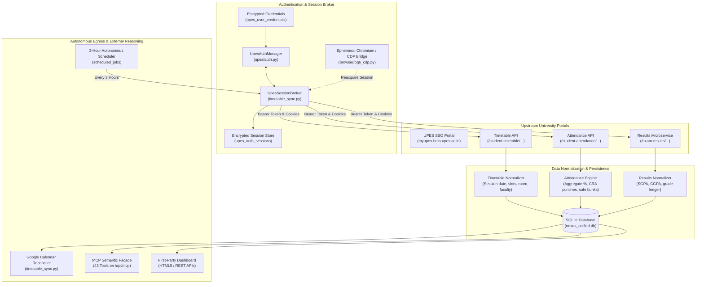

# Academic Data Pipeline Architecture & Implementation State

> **Status**: OBSERVED & AUDITED  
> **Target Subsystems**: Timetable Synchronization, Attendance Analytics, Results Ingestion, Google Calendar Reconciliation  
> **Last Audited**: 2026-10-21 (Phase 0 Reconnaissance)

---

## 1. End-to-End Pipeline Overview

---

## 2. Stage-by-Stage Implementation & Operational State

### Stage 1: UPES Authentication Resolution
- **Implementation File**: `upes/auth.py` (`UpesAuthManager`), `timetable_sync.py` (`UpesSessionBroker`)
- **Entry Functions**: `ensure_authenticated()`, `resolve_session()`
- **External Dependency**: `https://myupes-beta.upes.ac.in/sso/...`
- **Observed Runtime State**: `AUTH_REQUIRED` (0 active sessions in database)
- **Last Failure Evidence**: `timetable_sync_history` records `auth_required: UPES session expired or unavailable (Bridge: cdp_unavailable). Interactive portal login required.`
- **Recovery Path**: Import fresh session bundle via `/api/upes/auth/import` or browser CDP acquisition.

### Stage 2: Timetable Ingestion & Normalization
- **Implementation File**: `timetable_sync.py` (`TimetableService`)
- **Entry Functions**: `fetch_and_store_upes_timetable()`, `sync_timetable()`
- **Database Tables**: `user_timetables`, `academic_sessions`, `timetable_events_map`
- **Observed Runtime State**: 66 normalized sessions from August 2026 stored in `academic_sessions`. Live sync blocked by Stage 1 authentication.
- **Normalization Rules**: Dates normalized to ISO-8601 (`YYYY-MM-DD`), times to 24h format (`HH:MM:SS`), faculty whitespace trimmed, virtual room detection (MS Teams regex).

### Stage 3: Attendance Analytics Engine
- **Implementation File**: `attendance_sync.py` (`AttendanceService`)
- **Entry Functions**: `sync_user_attendance()`, `get_attendance_analytics()`
- **Database Tables**: `academic_modules`, `official_attendance_summaries`, `attendance_sync_history`
- **Observed Runtime State**: Fully operational mathematical projection based on LKG cache (66 conducted, 59 attended, 89.39% aggregate, 11 safe bunks, 1 critical subject).

### Stage 4: Google Calendar Reconciliation
- **Implementation File**: `timetable_sync.py` (`GoogleCalendarService`)
- **Entry Functions**: `sync_calendar_events()`, `reconcile_cached()`
- **External Dependency**: Google Calendar API v3
- **Observed Runtime State**: **Offline (`invalid_grant: Bad Request`)**. The Google OAuth refresh token has expired.
- **Critical Fix**: Commit `02a70c0` decoupled this stage from Stage 2 so that Stage 2 can complete even when Stage 4 fails.

### Stage 5: Three-Hour Scheduler
- **Implementation File**: `timetable_sync.py`, `app.py`
- **Entry Function**: `BackgroundScheduler.start()`
- **Database Table**: `scheduled_jobs` (`id: job_timetable_sync`, interval: 10,800s)
- **Observed Runtime State**: Configured, actively supervised, and dispatches every 3 hours, but terminates with `auth_required` due to Stage 1.
