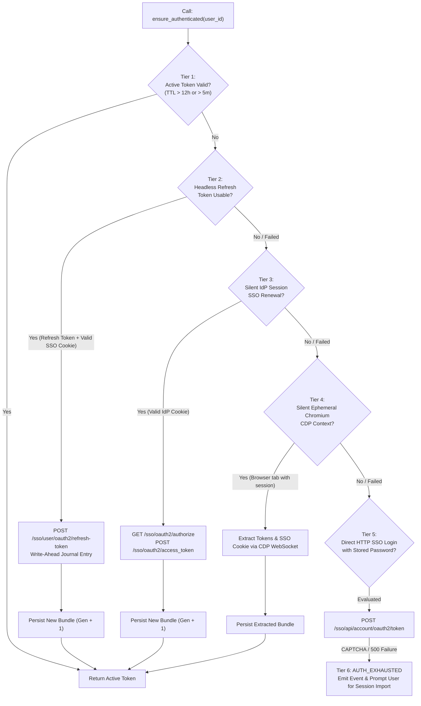

# Authentication Lifecycle & Session Broker Architecture

> **Status**: OBSERVED & AUDITED  
> **Target Subsystems**: UPES SSO, Google Calendar OAuth 2.0, First-Party JWT, MCP Client OAuth  
> **Last Audited**: 2026-10-21 (Phase 0 Reconnaissance)

---

## 1. Upstream UPES Authentication Architecture

UPES OnePortal uses a multi-tiered authentication architecture with non-aligned token lifespans:

| Credential / Artifact | Authoritative Origin | Observed Lifespan | Renewal Mechanism |
|---|---|---|---|
| **`access_token` (JWT)** | `/sso/user/oauth2/refresh-token` | ~1 Hour | Headless OAuth refresh via refresh token |
| **`refresh_token`** | Single-use rotating token | ~10-12 Hours | Rotated on every access token refresh |
| **`idp_session_info` (Cookie)** | Identity Provider session | **Fixed ~10-12 Hours** | **NOT extended by token refresh** |
| **Username / Password** | Institutional Active Directory | Indefinite | Blocked on direct HTTP by CAPTCHA / anti-bot challenge |

---

## 2. The 6-Tier Autonomy Pipeline

Implemented in [`upes/auth.py`](file:///e:/Workspace/Active/NexusNode/server/upes/auth.py) (`UpesAuthManager.ensure_authenticated`):

---

## 3. Google Calendar OAuth Lifecycle

- **Config Table**: `google_oauth_app_config`
- **Token Table**: `google_oauth_tokens`
- **Observed State**: `reauth_required: True` (`invalid_grant: Bad Request`).
- **Cause**: Google OAuth refresh tokens for projects in "Testing" publishing status expire after 7 days, or when explicitly revoked.
- **Remediation**: The user must visit `/api/auth/google/calendar` on the dashboard to re-consent with their Google account.

---

## 4. MCP Client Authentication

- **Discovery Endpoint**: `/.well-known/oauth-authorization-server`
- **Protected Resource**: `/.well-known/oauth-protected-resource`
- **Provider**: `agent/oauth_provider.py` (`OAuthProvider`)
- **Supported Flow**: OAuth 2.0 Authorization Code with PKCE (`S256`), Client Credentials
- **Observed State**: Operational on both LAN and `k09oezeyib.localto.net`.
